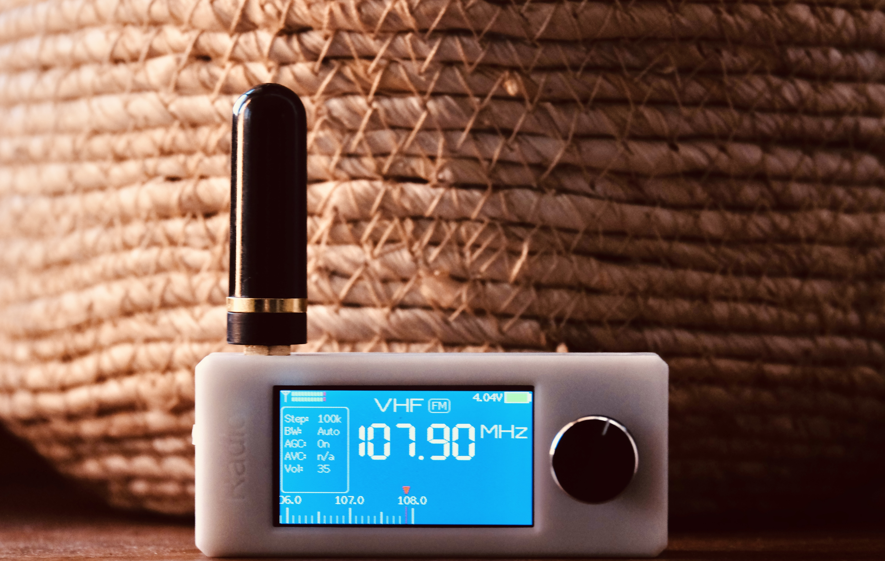

# ATS-Mini 汉化版固件（ats-mini-cn）



适用于 SI4732（ESP32-S3）Mini / Pocket 接收机的开源固件**简体中文汉化版**。

本仓库基于官方仓库 [esp32-si4732/ats-mini](https://github.com/esp32-si4732/ats-mini) **v2.45** 修改，
版本号与官方保持一致（`VER_APP 245`，标签 `v2.45`）。

- 原版说明见 [README.upstream.md](README.upstream.md)
- 官方文档：<https://esp32-si4732.github.io/ats-mini/>

## 固件下载

编译好的固件在 [Releases](https://github.com/openwrt-1983/ats-mini-cn/releases) 里，不用自己编：

| 文件 | 写入地址 | 用途 |
|---|---|---|
| `ats-mini-ospi-*-merged.bin` | `0x0` | 8 MB 整片镜像，推荐，网页整片刷写 |
| `ats-mini-ospi-*-app.bin` | `0x10000` | 仅应用分区，保留原有设置与电台 |

`*-bootloader.bin`、`*-partitions.bin`、`*-boot_app0.bin` 是分地址烧录用的单个分区文件，
一般不需要。每个 Release 的说明里都附了对应源码提交号和各文件的 MD5。

仓库本身不提交二进制（`build/` 在 `.gitignore` 里），固件一律走 Release 附件，避免仓库体积膨胀。

## 相对官方版的主要改动

### 1. 全界面简体中文

- 主菜单 14 项、设置菜单 22 项、各类状态提示、OTA 升级消息、关于页面全部汉化
- Web 管理页面全部汉化：状态、记忆频道、设置、Wi-Fi、固件升级、补丁 6 个页面，含按钮、表头、提示语、JS 报错信息
- **专业术语保留英文**：AGC、AVC、ATTN、BFO、RSSI、SNR、SSB、CW、LSB、USB、RDS、DSP、SI4732、S-Meter、BLE、HID、Wi-Fi、PSRAM、OTA 等不做翻译
- 内置 16px / 24px 两套中文点阵字体（Noto Sans CJK SC Light 子集，只收录界面用到的字，单色无抗锯齿），不依赖外部字库
- 字模按每个字的真实包围盒输出、中西文共用同一条基线，中英混排不再错位；笔画保持 Light 细体，小字号下依然清晰不糊

### 2. 新增「BLE 待机」休眠方式

设置 → 休眠方式 里新增第 4 项「BLE 待机」，按电视机待机的思路做——除了蓝牙，能关的全关：

- 熄屏、关背光、关 Wi-Fi
- 音频静音、功放使能拉低
- **SI4732 直接 `powerDown()` 断电**（这一块原来常开，是待机功耗的大头）
- CPU 主频降到 80 MHz
- 蓝牙广播间隔从 20~30 ms 放宽到 500 ms，够手机扫到，射频占空比降一个数量级
- 手机 App 仍可随时连接并控制，无需先唤醒设备；旋转编码器或按一下按键立即唤醒

唤醒时按冷启动流程把芯片重新上电并恢复原来的波段、频率、带宽、AGC/AVC 与 DSP 补丁，
所以唤醒后仍是原来那个台，代价是唤醒需要约 0.3 秒（和电视机开机同感）。

「CPU 睡眠」则是另一档：熄屏、关 Wi-Fi、CPU 降到 80 MHz，但**收音机不断音**，
音频与功放保持原样，合上屏幕可以继续听台，适合"边听边省电"。
两档的差别就是：BLE 待机最省电、听不了台；CPU 睡眠能听台、耗电高一些。

### 3. 修复蓝牙断连后无法重连

原版在客户端断开后只调用一次 `start()`，如果系统把广播停掉或 App 退出过快，广播不会真正恢复，导致 App 重新打开后搜不到设备。修改后：

- 断开连接后**延迟重新广播**（避开断开瞬间的控制器忙状态）
- 新增看门狗式检测：每轮循环检查 `isAdvertising()`，广播被停掉就自动重启
- BLE HID / Ad hoc 两种模式都适用

### 4. 编码器适配 15 电周期 / 30 定位点

- 按 30 定位点解码，一格 = 一个步进，不再出现「转两格才动一下」
- 设置菜单与 Web 设置页均可切换「编码器半步解码」，兼容 20 定位点等其它型号

## 编译

依赖（Arduino IDE 或 arduino-cli）：

| 组件 | 版本 |
|---|---|
| ESP32 Arduino Core | 3.3.12 |
| LovyanGFX | 1.2.33 |
| PU2CLR SI4735 | 2.1.8 |
| Async TCP | 3.5.0 |
| ESP Async WebServer | 3.12.1 |

```bash
cd ats-mini
arduino-cli compile --profile esp32s3-ospi --export-binaries .
# 或 QSPI 版本
arduino-cli compile --profile esp32s3-qspi --export-binaries .
```

> 若出现内存不足或中断，请把 `TMPDIR` 指到大容量磁盘目录再编译。

## 刷机

用 Chrome / Edge 打开 `flash.html`（需通过 http 访问）：选择 OSPI 或 QSPI、整片刷写，连接后自动写入。

- `*-merged.bin`：完整 8 MB 镜像，写入地址 `0x0`
- `ats-mini.ino.bin`：仅应用分区，写入地址 `0x10000`，保留原有设置

OSPI 版开机白屏时改刷 QSPI 版。

## 字体再生成

`FontCN16.h` / `FontCN24.h` 由 `tools/gen_font.py` 生成（需 freetype-py，源字体不随仓库分发）：

```
# 一次性准备：下载 Noto Sans CJK SC Light（约 16 MB）
curl -L -o tools/NotoSansCJKsc-Light.otf \
  https://github.com/notofonts/noto-cjk/raw/main/Sans/OTF/SimplifiedChinese/NotoSansCJKsc-Light.otf
pip install freetype-py

python3 tools/gen_font.py --font tools/NotoSansCJKsc-Light.otf
```

脚本会扫描固件源码里的全部中文字符，按真实包围盒生成字模并共用同一基线，生成后自动逐字校验解码是否正确。
修改界面文字后重新执行脚本即可。

## 说明

上游的 GitHub Actions 配置保留在 `.github/workflows.disabled/`（`build.yml`、`docs.yml`、`lint.yml`）。
需要启用 CI 时把它改名回 `.github/workflows/` 即可；推送这类文件要求 token 具备 `workflow` 权限。

## 许可

继承上游 [LICENSE](LICENSE)。
